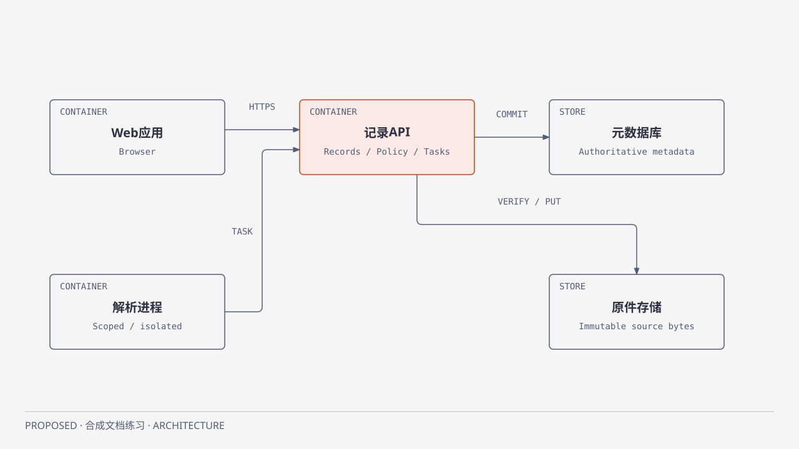

# L0 Overview：有权威边界的文件记录

SYN-FULL-B1，PROPOSED，system_approval_ref=null；[长期入口](README.md)提供按角色导航。当前目标是在小团队可维护的结构内可靠接管文件和发布派生文本，优先一个API中的Records/Policy/Task模块加一个隔离Parser进程，避免为了逻辑职责拆成许多服务。Parser单独运行是为限制不可信文件处理的资源与权限，代价是租约/迟到结果及重试协议。

[HTML](../diagrams/full-container.html) · [SVG](../diagrams/full-container.svg)。这张C4 Container图展示运行软件/数据边界。重要关系是Parser经API领取固定版本任务并提交候选，不能直接写数据库或原件；API才拥有最终发布权。职责详见[结构](views/structure.md)，位置见[部署](views/deployment.md)。

原件字节不可变，记录ID不来自路径/hash；元数据和当前修订由Records控制，派生文本只在输入仍current且权限有效时发布。文件存储与数据库不是一个事务，以持久Operation和核验恢复接缝处理，完整定义在[Records](modules/records.md)。公共权限/错误/CAS/幂等规则只在[CONTRACTS](CONTRACTS.md)维护；Overview不复制字段表。

目标质量是撤权后不新增发布/读取、重试不重复创建、崩溃不丢唯一验证字节；可观察场景与未测状态见[风险质量](views/security-quality.md)。不承诺未经验证的SLO。主要未知是受管存储的条件创建/完整性能力与备份恢复方案，详见[ADR-001](adr/ADR-001.md)。本轮仅合成设计和图表验证，不做真实文件、数据库、迁移或生产恢复。

L1→系统视图；L2→Records/Parsing；L3→Records中的当前SYN-FULL-F01具体行为/伪签名/验收。真实实施还须按批准系统补完整Feature Spec/OpenAPI/DDL并取得编码授权，不把这些草案转成既定技术。
