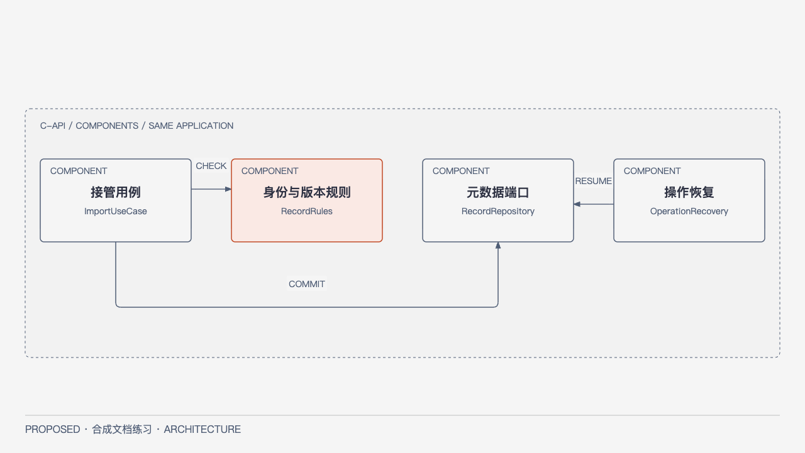

# L2 Records：接管、身份与恢复

状态PROPOSED；消费[系统候选SYN-FULL-B1](../README.md)，system_approval_ref=null。仅文档试验草案，不能完成正式Module Ready。当前Feature SYN-FULL-F01是可靠接管文件；删除/恢复只定义安全边界，永久销毁未授权。

## 职责与组件

Records拥有Record、SourceRevision、Operation、受管对象键及文件接管/恢复；Policy判权限，Tasks拥有任务/租约，Parser只计算。Records不治理身份源、不解析、不把派生文本变原件。存储适配器只在限定根/对象命名空间内操作，拒绝任意客户端路径、根逃逸、符号链接逃逸；实际对象存储能力待验证。

[HTML](../../diagrams/full-component.html) · [SVG](../../diagrams/full-component.svg)。C4 Component，仅API内Records边界：UseCases编排Rules、Repository及Recovery；Recovery恢复已持久化操作，不是独立服务。外部Policy/Tasks/字节存储端口在下表，不把其他模块复制进本图。源/关系模型固定在[model](../../model.json)。

候选代码为api/records/usecases（编排）、rules（纯不变量）、repository（短事务与CAS）、recovery（阶段恢复）、storage-adapter（受限IO）。依赖UseCases→Rules/端口，adapter实现端口，规则不调用DB/网络；这些是实现接缝而非已存在代码。

## 数据与不变量（完整规则）

Record={record_id,owner_id,lifecycle,current_source_revision,row_revision}。稳定ID不可复用且不来自文件名/hash/path；current只指本Record已验证字节。SourceRevision={record_id,source_revision,hash,size,storage_key}，版本/字节不可改写；新字节显式新修订，旧修订按保留策略保全；重新解析不增加source_revision。row_revision用于人工并发，generation_id只属派生代次，不混作一个版本。

Operation={operation_id,principal,kind,key,payload_fingerprint,expected_revision,stage,verified_hash,staging_key,final_key,stable_result}，同operation串行恢复与在线重试；不只靠内存锁。唯一已验证字节不得为清理/回滚而删除；原用户输入成功前不删。同名异内容不覆盖，不跨权限域查重泄露存在。此例不自动按hash合并记录。

## 端口、事务与当前L3行为

`ImportUseCase.begin(ctx,manifest,key)->Accepted(operation_id)`；`commit(ctx,operation_id)->Pending|Committed(record_id,source_revision)|Invalid|Denied`；`Recovery.resume(operation_id)->Stage|StableResult|NeedsIntervention`。查询/错误/权限沿[公共契约](../CONTRACTS.md)。UseCases消费 `Policy.authorize`、`ManagedBytes.reserve/verify/place`、`Repository.commitWithTask`；Tasks经受限端口在同一元数据事务登记固定输入任务，Records不直接写Tasks表。

SYN-FULL-F01具体顺序：验证principal/import权限和manifest→持久PREPARED→受管私有staging接收并验hash/size→持久VERIFIED→条件创建不可变final对象并核验→短事务再次授权/CAS、登记Record/Revision/Task和稳定响应，记COMMITTED→仅清本次可丢弃staging，记CLEANED。数据库与字节存储不是一个原子事务；IO不放进长DB事务。Task与Record同元数据事务登记，避免已提交但永不解析；不能把Task放到无保障的提交后回调。

## 失败、并发与恢复（完整规则）

| 断点/失败 | 权威与恢复 |
| --- | --- |
| PREPARED上传缺块/满额/hash不符 | 无可读新Record；保留诊断/可续部分；拒绝混合源，满额暂停，禁止删除已验证原件腾空间 |
| VERIFIED或final已就位，目录未提交 | 以原operation与hash核验后重做同一事务或隔离；不扫文件名建立第二Record，不公开未登记字节 |
| COMMITTED响应丢失 | 已提交Record/稳定结果权威，同key返回同结果；不再生成Record/任务或重做安放 |
| 清理失败 | 记录已提交仍有效，仅恢复可证明安全的staging清理，不回滚到不存在 |
| 慢IO期间撤权/版本改变 | 正式提交前复验，拒绝旧change set，保留受控诊断；不自动换key覆盖 |
| 外部篡改/缺失 | 先查operation/存储可达性/备份；hash冲突隔离，不静默换source_revision；歧义NeedsIntervention |

同一Record有活动文件操作时以持久占位/CAS拒绝冲突操作，恢复器也取得相同占位；实现锁/索引DDL尚待批准后细化。tombstone只是逻辑隐藏并增row_revision；读和发布都核验lifecycle，不等派生物理删除。restore先核验保留的current_source_revision对应字节/hash和当前权限，再按expected_revision校验当前row_revision，在同一记录事务解除tombstone并递增row_revision。此处不新建或改写source_revision/current_source_revision，也不把generation_id当作恢复版本；不复活旧lease。是否需要重新解析须按当前源修订与现有发布校验另行判断，不能通过restore把旧任务或旧派生结果直接视为新发布。purge/备份销毁/保留期限未批，不实现永久删除。备份需一致元数据与被引用字节清单且全部可核验；恢复前隔离核验并使旧租约失效，具体介质/密钥/阈值见待决ADR，不能把同存储冗余当独立备份。

## 验收与停止点

全部是设计，产品NOT RUN：每阶段崩溃后同operation收敛；提交后丢响应重试不重复；hash/size错不发布；满额不删原件；撤权不提交；并发CAS一成一冲突；篡改隔离；tombstone后旧Parser不可发布；restore仅递增row_revision、保留原source_revision/current_source_revision且不复活旧lease或自动发布旧generation。接缝为受管存储、Repository事务、Policy和Recovery故障注入。

正式系统批准、完整Feature/OpenAPI/DDL、对象存储条件创建/持久性实测、资源限额和恢复演练仍UNKNOWN/NOT RUN；D1/D2见[ADR](../adr/ADR-001.md)。来源状态见[Source Map](../SOURCE-MAP.md)。Coder不能把此文当获准实施任务。
