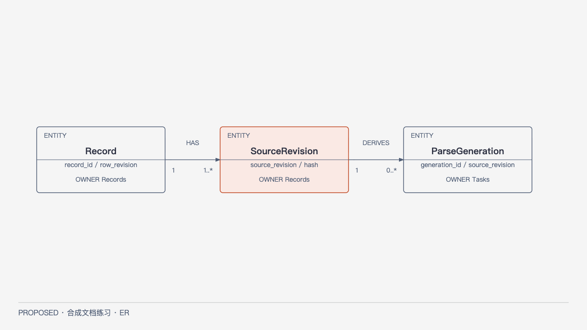

# Data：原始修订与可重建派生

PROPOSED；概念ER，不是物理DDL或完整字段Schema。权威字段/不变量在[Records](../modules/records.md)和[Parsing](../modules/parsing.md)，关系投影来自[model](../../model.json)。

[HTML](../../diagrams/full-data.html) · [SVG](../../diagrams/full-data.svg)。Record拥有一个或多个SourceRevision，每个修订可有零到多个ParseGeneration；箭头方向为包含/来源关联，端点标1与1..*/0..*，不是跨模块写权限。重要关系是派生代次绑定精确原始修订，不能替换原件权威。

Records写Record/SourceRevision，Tasks管理ParseGeneration/Publication；原始字节在C-BYTES，元数据在C-META。图只展示三类关键实体及身份字段；Operation/Task/Policy为相邻控制域，完整语义在对应契约，不因未画而允许自由实现。Publication只指完整可用代，撤权/生命周期影响读取与发布。

备份必须覆盖不可重建的原件、身份/版本/权限/操作记录，派生可按固定输入重建。未定保留/恢复政策明确在ADR，不为图补造永久删除规则或数值。物理表/索引/约束待正式设计，数据库/恢复测试NOT RUN。
