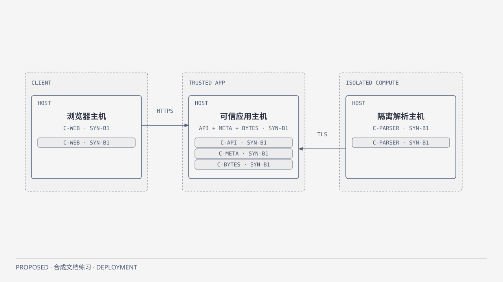

# Deployment：应用与隔离计算

PROPOSED，仅示例环境，非已部署事实。抽象为Container实例到主机/信任环境；权威模型[model](../../model.json)。

[HTML](../../diagrams/full-deployment.html) · [SVG](../../diagrams/full-deployment.svg)。展示Browser主机、可信应用主机、隔离解析主机三个环境及其候选工件。重要关系：Parser仅以任务身份经TLS访问API，不能进入元数据/原件管理面。Browser经HTTPS入口，外部身份校验由Context说明。应用主机内API、元数据与受管字节实例为候选同环境放置，不代表它们同进程或同一事务。

工件标记SYN-B1是设计修订，不冒充软件版本；真实框架、操作系统、TLS端口/证书、存储挂载/凭据与实例数量均待选。图以1候选实例表达当前假设，不宣称高可用。API故障不切换Parser为权威；Parser关闭只积压派生处理。数据库或字节存储不可达则拒绝依赖写/读，恢复步骤按模块契约，不创建客户端可写回退。

图省略主机内详细存储连线，由Container定义API存储关系；部署视图中的Host关系绑定实例映射，不能把聚合主机线误解为Parser直接写DB。生产部署、安全加固与故障/容量测试均NOT RUN，部署/恢复另需授权。
