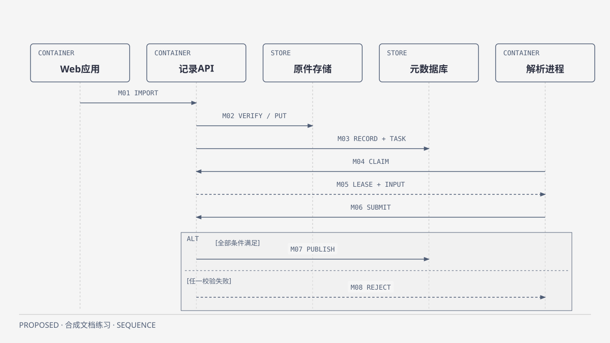

# Runtime：固定修订解析与拒绝

PROPOSED；抽象为时间有序消息，不新增服务。权威规则：[Records](../modules/records.md)、[Parsing](../modules/parsing.md)、[公共契约](../CONTRACTS.md)。

[HTML](../../diagrams/full-runtime.html) · [SVG](../../diagrams/full-runtime.svg)。先看API完成字节核验和目录/任务登记，再看Parser领取与提交；ALT上支是全部条件满足才发布，下支是旧epoch/源变化/撤权/不完整则拒绝。消息ID及顺序来自[model](../../model.json)，图不把“上传成功”与“解析已发布”混成一次成功。

图选择正常接管→异步解析→发布或拒绝的代表流程，省略分块/完整错误枚举和每个崩溃点，完整恢复必须读Records，不能用时序图替代契约。图中发布事务仍要求lease有效、当前source/Policy、完整manifest校验，不因线落在数据库上就授予Parser直写。

失败推演：API提交后网络断开沿原operation查询，不新建记录；Parser重领任务增加epoch；旧提交即使hash正确也拒绝；源tombstone或撤权同样拒绝。首次正文未就绪返回Pending，旧代不能伪装新源正文。均为设计，产品运行NOT RUN。
