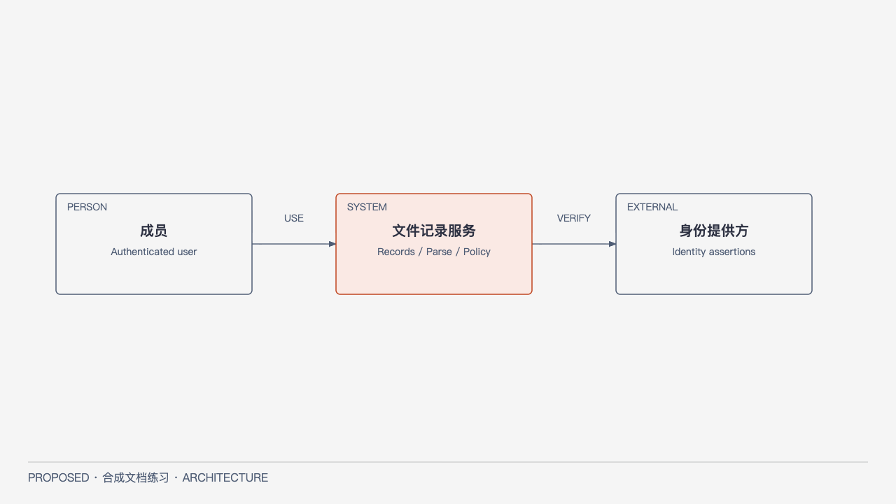
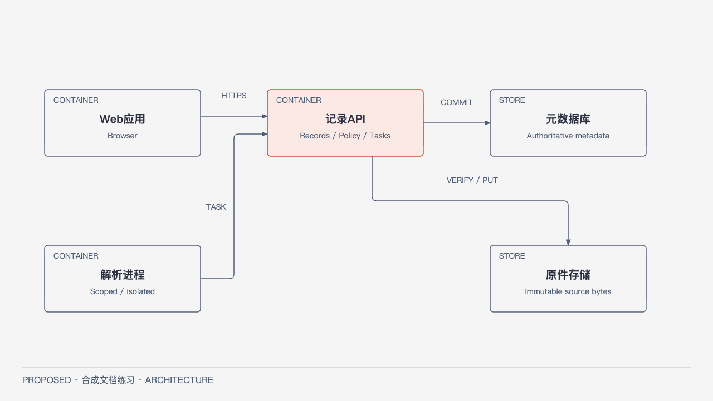

# L1 结构：边界与运行单元

状态PROPOSED；语义源[model.json](../../model.json)，本页为结构职责权威。图只表达本页模型，不定义API字段。

## Context

[HTML](../../diagrams/full-context.html) · [SVG](../../diagrams/full-context.svg)。C4 System Context：成员向文件记录服务提交/读取，外部身份提供方提供可验证身份声明。系统对记录/权限/解析发布负责，身份提供方对身份认证负责；上传文件是不可信数据，不是可执行指令。聚合全部内部运行单元为一个系统，下一层再展开。排除存储/API内部、主机和类。

## Container

[HTML](../../diagrams/full-container.html) · [SVG](../../diagrams/full-container.svg)。C4 Container：Web浏览器应用、API应用、Parser进程、元数据库、原件存储。主要关系为Web→API、Parser→API，API→两类存储。Parser无DB/原件存储长期凭据，也不做用户授权决定。图省略Context的成员/身份提供方，见上图；没有省掉隐含直接写路径。

| 稳定ID | 职责/所有者 | 不负责 |
| --- | --- | --- |
| C-WEB | 输入、显示原件接管与解析状态 | 不自报角色、决定写权限、持有服务端凭据 |
| C-API | Records/Policy/Tasks模块；授权、记录事务、租约与最终发布 | 不在请求事务中同步解析文件 |
| C-PARSER | 受限解析固定修订；产候选结果 | 不直接读写DB，不改记录current/权限 |
| C-META | Record/Revision/Operation/Task/Policy/Publication元数据 | 不保存唯一原始文件字节 |
| C-BYTES | 受管不可变字节，API经限定对象键访问 | 不凭客户端路径/hash自动改变记录身份 |

API内部Records拥有身份/版本与恢复，Policy拥有授权，Tasks拥有租约与派生发布；它们是Component，不是三个服务。候选代码映射：web入口、api入口、parser入口；API的records/policy/tasks包与storage适配层，入口→用例→规则。只有当前Records模块内部接缝进一步画Component，其他模块不预先细化所有类。

候选技术是团队现有Web/API/关系存储能力加受管字节存储，不固定厂商/版本。采用单API内部模块减少跨服务事务；Parser隔离增加协议成本但限制不可信内容。简单替代“请求内同步解析”会把用户延迟与崩溃直接绑到不可信输入，需实测后由Owner决定是否接受折中；无业务实现或实测结论。
