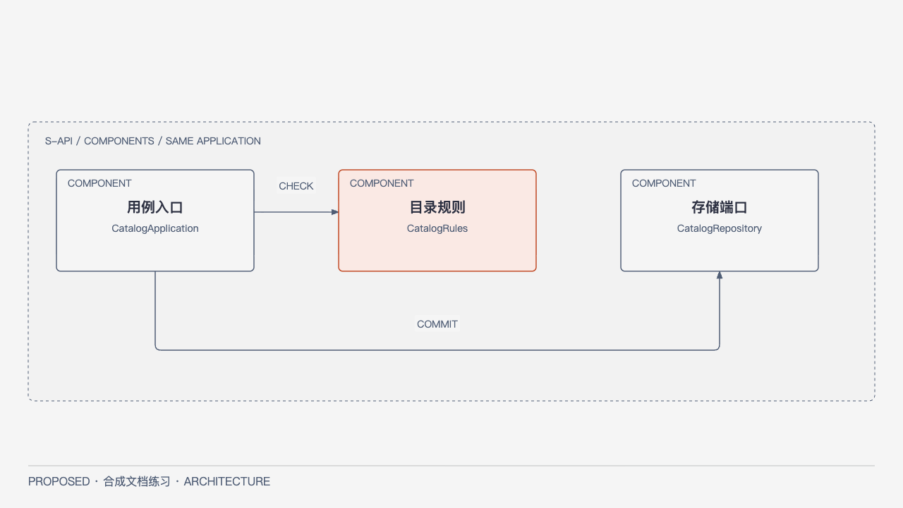

# Catalog：当前模块契约

SYN-STD-F01，基线[PROPOSED SYN-STD-B1](OVERVIEW.md)，文档练习，不是正式Module Ready。Catalog负责记录创建/读取/改名；Policy负责身份和对象授权；数据库adapter负责短事务。排除文件上传、异步解析、同步与权限编辑。模块候选包catalog/application、catalog/rules、catalog/adapter；避免无当前用途的额外服务。

## 接口和数据（本例唯一完整定义）

Web消费API：`POST /records {title,key}` → 已提交记录；`GET /records/{id}` → 可见Record；`PATCH /records/{id} {title,expected_revision,key}` → 新revision。已验证principal由服务端上下文提供，不能接受自报角色。无权或不存在统一NotFound；未认证Unauthenticated。写要求当前Policy可写和非空title；Conflict不自动覆盖。错误体为code/request_id，日志不含内容。

Record={record_id,title,revision,owner_id}，record_id稳定且不可由title推导；Catalog唯一写入内容，Policy唯一判定权限。修改在同一事务完成revision比较、更新和稳定幂等结果；幂等范围为principal+operation+key+payload fingerprint，同键异载荷Conflict；响应丢失沿原key查询/重试。两个设备改同revision仅一个成功；无新增授权即使旧revision有效也拒绝。

## 顺序、失败与验收

输入校验→身份/Policy→短事务再次验证权限/版本→写与幂等结果提交→返回；失败不显示已保存。服务不可用保留用户输入并明确重试；未知是否提交沿原key查询，不发新key覆盖。GET不产生业务写入。数据库不可用不降级到客户端可写权威。

测试设计NOT RUN：并发同revision（一成功一冲突）；重复同key同载荷（同结果）；同key异载荷（冲突）；未认证/撤权（拒绝且不泄露对象）；提交后丢响应（不重复）；空title（明确校验失败且保留输入）。具体HTTP schema/状态码和字段长度、技术版本仍UNKNOWN，需批准系统后由MA深化，不由Coder猜测。本例不增加Deployment/Sequence/ER图；原scope模块必需图由下方有效系统内组件图满足，而非因Standard被省略。

[HTML](../diagrams/standard-component.html) · [SVG](../diagrams/standard-component.svg)。C4 Component在API边界内仅展开当前Catalog的用例入口、规则和存储端口；非三项新服务，Policy作为外部模块依赖在正文定义。图不承担完整接口Schema，以上正文是权威。
