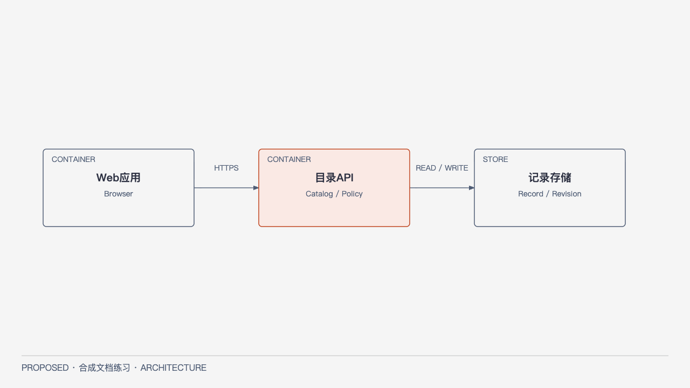

# Standard：团队记录目录

**SYNTHETIC / PROPOSED；system_approval_ref=null。** 示例SYN-STD-B1，Profile=Standard、architecture_scope=both（系统后当前Catalog模块草案）。这是通用中型Web/API设计练习，需实际批准系统基线后才能完成正式Module Ready。

目标是让团队维护有权限的短记录目录。Web负责输入/展示，API负责Catalog和授权，关系数据存储负责持久化。当前无二进制文件、异步计算、离线副本或跨资源恢复需求；一个模块化API比拆服务更易维护，代价是应用同版本部署。技术选择候选为现有团队Web栈、类型化HTTP API和关系数据库；具体版本/运行环境未选，本稿不伪造已部署平台。

[HTML](../diagrams/standard-container.html) · [SVG放大](../diagrams/standard-container.svg)。图是C4 Container，展示浏览器Web、API和数据库三个运行边界；最重要的关系是Web经API访问受权威权限约束的数据，不直连数据库。API内部Catalog/Policy是逻辑模块，详见[Module与完整局部契约](MODULE.md)。

SA维护本页系统边界；Catalog拥有记录内容/修订，Policy提供授权判定，不各存一套权限规则。应用级目录候选为web入口、api入口、catalog与policy包、关系存储adapter，依赖入口→用例→规则；此为设计映射，非已实现代码。

Master读本页及下方待决；MA/Coder/QA直接读MODULE的职责、接口、不变量、失败和验收，再核验真实批准；Reviewer固定准确diff/模型和正文。无需本例补Full全部视图：无独立部署风险所以部署先文字说明同一应用环境，运行是短请求/事务所以用契约步骤，数据仅记录修订所以用模块字段表。若引入跨环境/异步/文件/恢复，增加对应视图并重新评估。

质量目标为授权一致、并发不覆盖与请求可诊断，验证设计在MODULE；吞吐/恢复SLO未测。未批：团队具体栈/环境、保留期限、正式系统批准与Feature Spec。没有离线或永久删除承诺。此文档不属于真实产品审批。
